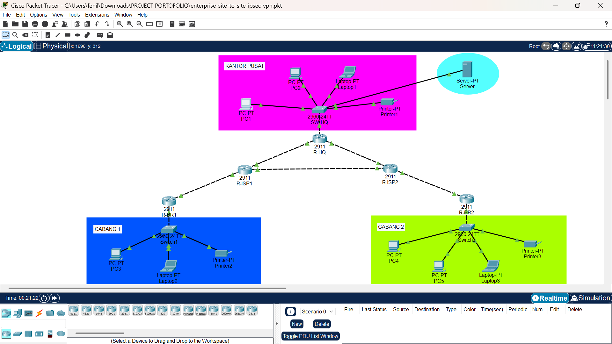
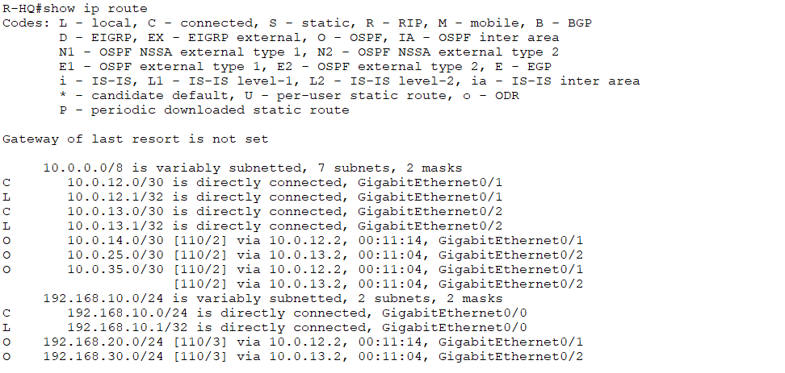

# Enterprise Site-to-Site IPsec VPN

## Deskripsi Project

Project ini merupakan simulasi jaringan dan keamanan menggunakan Cisco Packet Tracer dengan implementasi VPN Site-to-Site IPsec dan routing dinamis OSPF.

Topologi menghubungkan jaringan kantor pusat (*Head Office/HQ*) dengan dua kantor cabang, yaitu Branch 1 (BR1) dan Branch 2 (BR2), melalui dua router ISP. OSPF digunakan untuk mendistribusikan informasi routing antarrouter, sedangkan IPsec VPN dikonfigurasi untuk melindungi komunikasi antara jaringan LAN kantor pusat dan masing-masing kantor cabang.

Topologi juga mencakup perangkat pendukung berupa PC, laptop, printer, dan server untuk merepresentasikan lingkungan jaringan perusahaan.

Project ini dibuat untuk mempraktikkan konfigurasi routing dinamis, VPN IPsec, pengalamatan IP, verifikasi tabel routing, serta pengujian konektivitas antarjaringan.

## Tujuan Project

- Merancang topologi jaringan multi-site menggunakan Cisco Packet Tracer.
- Mengonfigurasi routing dinamis OSPF pada Area 0.
- Mengimplementasikan VPN IPsec Site-to-Site antara HQ dan BR1.
- Mengimplementasikan VPN IPsec Site-to-Site antara HQ dan BR2.
- Memahami penggunaan ISAKMP/IKE dan IPsec transform set.
- Mengonfigurasi ACL untuk menentukan trafik yang dilindungi VPN.
- Memverifikasi adjacency OSPF dan tabel routing.
- Memeriksa status koneksi VPN menggunakan perintah verifikasi IPsec.
- Menguji konektivitas antar-PC menggunakan `ping`.
- Melakukan troubleshooting routing dan konektivitas jaringan.

## Teknologi yang Digunakan

| Teknologi | Fungsi |
|---|---|
| Cisco Packet Tracer | Simulasi dan pengujian jaringan |
| Cisco 2911 Router | Routing dan terminasi VPN |
| Cisco Catalyst 2960 | Menghubungkan perangkat dalam LAN |
| IPv4 | Pengalamatan jaringan |
| OSPF Area 0 | Routing dinamis antarrouter |
| IPsec VPN | Melindungi komunikasi antarjaringan sesuai kebijakan VPN |
| ISAKMP/IKE | Negosiasi parameter keamanan VPN |
| AES | Enkripsi VPN |
| ESP-SHA-HMAC | Integritas paket IPsec |
| Crypto Map | Mengaitkan peer dan kebijakan IPsec |
| Access Control List (ACL) | Menentukan trafik yang dilindungi VPN |

## Topologi Jaringan



Topologi terdiri dari lima router Cisco 2911, tiga switch Cisco Catalyst 2960, beberapa PC, tiga laptop, tiga printer, dan satu server.

### Perangkat dan Perannya

#### 1. Kantor Pusat (HQ)

- **R-HQ:** Router utama kantor pusat yang menghubungkan LAN HQ dengan dua jalur ISP dan menjadi endpoint VPN.
- **SW-HQ:** Switch yang menghubungkan perangkat LAN kantor pusat.
- **PC1 dan PC2:** Perangkat untuk pengujian konektivitas.
- **Laptop1:** Perangkat akhir tambahan pada LAN kantor pusat.
- **Printer1:** Perangkat printer jaringan kantor pusat.
- **Server:** Perangkat layanan jaringan yang ditempatkan di kantor pusat. Jenis layanan dan konfigurasi IP-nya perlu disesuaikan dengan konfigurasi aktual.

#### 2. Cabang 1 (BR1)

- **R-BR1:** Router cabang pertama dan endpoint VPN dengan HQ.
- **Switch1:** Menghubungkan perangkat LAN BR1.
- **PC3:** Perangkat yang digunakan dalam pengujian konektivitas BR1.
- **Laptop2:** Perangkat akhir tambahan pada LAN BR1.
- **Printer2:** Perangkat printer jaringan cabang pertama.

#### 3. Cabang 2 (BR2)

- **R-BR2:** Router cabang kedua dan endpoint VPN dengan HQ.
- **Switch2:** Menghubungkan perangkat LAN BR2.
- **PC4 dan PC5:** Perangkat untuk pengujian konektivitas.
- **Laptop3:** Perangkat akhir tambahan pada LAN BR2.
- **Printer3:** Perangkat printer jaringan cabang kedua.

#### 4. Jaringan ISP

- **R-ISP1:** Router ISP yang menghubungkan HQ, BR1, dan ISP2.
- **R-ISP2:** Router ISP yang menghubungkan HQ, BR2, dan ISP1.

### Alur Koneksi

- Perangkat LAN HQ terhubung ke SW-HQ, kemudian ke R-HQ.
- Perangkat LAN BR1 terhubung ke Switch1, kemudian ke R-BR1.
- Perangkat LAN BR2 terhubung ke Switch2, kemudian ke R-BR2.
- R-HQ terhubung ke R-ISP1 dan R-ISP2.
- R-ISP1 terhubung ke R-BR1 dan R-ISP2.
- R-ISP2 terhubung ke R-BR2.
- VPN IPsec dikonfigurasi antara HQ dan BR1 serta antara HQ dan BR2.

OSPF digunakan untuk mempelajari rute jaringan melalui topologi WAN. VPN IPsec melindungi trafik yang sesuai dengan kebijakan ACL crypto pada masing-masing tunnel.

## Skema Alamat IP

### Tabel Pengalamatan IP LAN

| Lokasi | Network Address | Gateway |
|---|---|---|
| HQ | `192.168.10.0/24` | `192.168.10.1` |
| BR1 | `192.168.20.0/24` | `192.168.20.1` |
| BR2 | `192.168.30.0/24` | `192.168.30.1` |

### Tabel Pengalamatan IP WAN

| Koneksi | Network Address | Alamat IP |
|---|---|---|
| HQ – ISP1 | `10.0.12.0/30` | HQ: `10.0.12.1`, ISP1: `10.0.12.2` |
| HQ – ISP2 | `10.0.13.0/30` | HQ: `10.0.13.1`, ISP2: `10.0.13.2` |
| ISP1 – BR1 | `10.0.14.0/30` | ISP1: `10.0.14.1`, BR1: `10.0.14.2` |
| ISP2 – BR2 | `10.0.25.0/30` | ISP2: `10.0.25.1`, BR2: `10.0.25.2` |
| ISP1 – ISP2 | `10.0.35.0/30` | ISP1: `10.0.35.1`, ISP2: `10.0.35.2` |

### Tabel IP PC Pengujian

| Perangkat | IP Address | Default Gateway |
|---|---|---|
| PC1 (HQ) | `192.168.10.10` | `192.168.10.1` |
| PC3 (BR1) | `192.168.20.10` | `192.168.20.1` |
| PC4 (BR2) | `192.168.30.10` | `192.168.30.1` |

IP laptop, printer, PC tambahan, dan server tidak dicantumkan karena alamatnya belum didokumentasikan dalam hasil konfigurasi yang tersedia.

### Pembagian Jaringan

| Network Address | Fungsi |
|---|---|
| `192.168.10.0/24` | LAN kantor pusat |
| `192.168.20.0/24` | LAN kantor cabang 1 |
| `192.168.30.0/24` | LAN kantor cabang 2 |
| `10.0.12.0/30` | Link HQ–ISP1 |
| `10.0.13.0/30` | Link HQ–ISP2 |
| `10.0.14.0/30` | Link ISP1–BR1 |
| `10.0.25.0/30` | Link ISP2–BR2 |
| `10.0.35.0/30` | Link antar-ISP |

## Konfigurasi Routing OSPF

OSPF dikonfigurasi menggunakan Process ID 1 pada Area 0. Setiap router mengiklankan jaringan LAN atau WAN yang terhubung langsung sesuai topologi.

### Konfigurasi OSPF pada R-HQ

```cisco
router ospf 1
 network 192.168.10.0 0.0.0.255 area 0
 network 10.0.12.0 0.0.0.3 area 0
 network 10.0.13.0 0.0.0.3 area 0
```

### Jaringan yang Diiklankan

- **R-HQ:** `192.168.10.0/24`, `10.0.12.0/30`, `10.0.13.0/30`
- **R-ISP1:** `10.0.12.0/30`, `10.0.14.0/30`, `10.0.35.0/30`
- **R-ISP2:** `10.0.13.0/30`, `10.0.25.0/30`, `10.0.35.0/30`
- **R-BR1:** `192.168.20.0/24`, `10.0.14.0/30`
- **R-BR2:** `192.168.30.0/24`, `10.0.25.0/30`

### Verifikasi OSPF

Perintah yang digunakan:

```cisco
show ip ospf neighbor
show ip ospf database
show ip route
show ip protocols
```

Perintah tersebut digunakan untuk memeriksa adjacency OSPF, database link-state, jaringan yang dipelajari, dan konfigurasi protokol routing.

## Konfigurasi VPN IPsec Site-to-Site

VPN IPsec dikonfigurasi untuk menghubungkan kantor pusat dengan kedua kantor cabang.

### VPN HQ–BR1

- Peer lokal R-HQ menggunakan alamat WAN `10.0.12.1`.
- Peer remote R-BR1 adalah `10.0.14.2`.
- LAN HQ: `192.168.10.0/24`.
- LAN BR1: `192.168.20.0/24`.

### VPN HQ–BR2

- Peer lokal R-HQ menggunakan alamat WAN `10.0.13.1`.
- Peer remote R-BR2 adalah `10.0.25.2`.
- LAN HQ: `192.168.10.0/24`.
- LAN BR2: `192.168.30.0/24`.

### Parameter Keamanan VPN

| Parameter | Konfigurasi |
|---|---|
| Autentikasi | Pre-shared key |
| Enkripsi ISAKMP | AES |
| Diffie-Hellman Group | 2 |
| Enkripsi IPsec | ESP-AES |
| Integritas IPsec | ESP-SHA-HMAC |
| Identifikasi trafik | Crypto ACL |
| Pengaitan kebijakan VPN | Crypto map |

### Verifikasi VPN

```cisco
show crypto isakmp sa
show crypto ipsec sa
```

Perintah `show crypto isakmp sa` digunakan untuk memeriksa status negosiasi IKE/ISAKMP. Perintah `show crypto ipsec sa` digunakan untuk memeriksa parameter IPsec dan penghitung paket terenkripsi maupun terdekripsi.

## Kebijakan Keamanan Jaringan

Kebijakan VPN menentukan trafik LAN yang dilindungi IPsec.

| Sumber | Tujuan | Kebijakan |
|---|---|---|
| LAN HQ (`192.168.10.0/24`) | LAN BR1 (`192.168.20.0/24`) | Dilindungi VPN IPsec |
| LAN BR1 (`192.168.20.0/24`) | LAN HQ (`192.168.10.0/24`) | Dilindungi VPN IPsec |
| LAN HQ (`192.168.10.0/24`) | LAN BR2 (`192.168.30.0/24`) | Dilindungi VPN IPsec |
| LAN BR2 (`192.168.30.0/24`) | LAN HQ (`192.168.10.0/24`) | Dilindungi VPN IPsec |

ACL crypto menentukan trafik yang cocok dengan kebijakan IPsec. Trafik lain tidak otomatis menjadi bagian dari VPN hanya karena OSPF memiliki rute menuju jaringan tersebut.

## Konfigurasi Access Control List (ACL)

ACL crypto pada R-HQ menentukan trafik yang akan dilindungi oleh masing-masing tunnel.

### ACL HQ–BR1

```cisco
access-list 110 permit ip 192.168.10.0 0.0.0.255 192.168.20.0 0.0.0.255
```

ACL tersebut mencocokkan trafik IP dari LAN HQ menuju LAN BR1.

### ACL HQ–BR2

```cisco
access-list 120 permit ip 192.168.10.0 0.0.0.255 192.168.30.0 0.0.0.255
```

ACL tersebut mencocokkan trafik IP dari LAN HQ menuju LAN BR2.

Pada sisi cabang, ACL crypto harus mencocokkan pasangan jaringan yang sama dengan arah sumber dan tujuan terbalik.

**Catatan:** keberhasilan ping antar-cabang tidak otomatis membuktikan bahwa trafik BR1–BR2 dienkripsi oleh IPsec. ACL dan counter IPsec perlu diperiksa secara terpisah untuk memastikan jalur keamanan trafik tersebut.

## Pengujian Konektivitas

Pengujian dilakukan menggunakan perintah `ping` dari PC kantor pusat ke kedua cabang serta dari PC BR1 menuju PC BR2.

### 1. PC HQ ke PC BR1

Perintah:

```text
ping 192.168.20.10
```

Hasil:

```text
Packets: Sent = 4, Received = 4, Lost = 0 (0% loss)
```

**Status: Berhasil.**

PC HQ berhasil menjangkau PC BR1 tanpa kehilangan paket.

### 2. PC HQ ke PC BR2

Perintah:

```text
ping 192.168.30.10
```

Hasil:

```text
Packets: Sent = 4, Received = 4, Lost = 0 (0% loss)
```

**Status: Berhasil.**

PC HQ berhasil menjangkau PC BR2 tanpa kehilangan paket.

### 3. PC BR1 ke PC BR2

Perintah yang dijalankan dari PC BR1:

```text
ping 192.168.30.10
```

Hasil:

```text
Packets: Sent = 4, Received = 4, Lost = 0 (0% loss)
Minimum = 0ms, Maximum = 1ms, Average = 0ms
```

**Status: Berhasil.**

PC BR1 berhasil menjangkau PC BR2 dengan empat paket diterima dan tanpa kehilangan paket.

Hasil ini membuktikan konektivitas IP antara kedua PC, tetapi tidak membuktikan bahwa trafik BR1–BR2 melewati tunnel IPsec.

### Ringkasan Pengujian

| Sumber | Tujuan | Hasil |
|---|---|---|
| PC1 HQ (`192.168.10.10`) | PC3 BR1 (`192.168.20.10`) | Berhasil, 4/4 paket diterima |
| PC1 HQ (`192.168.10.10`) | PC4 BR2 (`192.168.30.10`) | Berhasil, 4/4 paket diterima |
| PC3 BR1 (`192.168.20.10`) | PC4 BR2 (`192.168.30.10`) | Berhasil, 4/4 paket diterima |

## Verifikasi Konfigurasi

### Tabel Routing R-HQ

```cisco
show ip route
```

Hasil pemeriksaan menunjukkan rute OSPF menuju kedua LAN cabang:

```text
O 192.168.20.0/24 [110/3] via 10.0.12.2
O 192.168.30.0/24 [110/3] via 10.0.13.2
```

Rute tersebut menunjukkan bahwa jaringan BR1 dipelajari melalui ISP1 dan jaringan BR2 dipelajari melalui ISP2.

### Verifikasi Neighbor dan Database OSPF

```cisco
show ip ospf neighbor
show ip ospf database router
```

Perintah tersebut digunakan untuk memeriksa adjacency OSPF dan informasi Router LSA.

### Verifikasi Status VPN

```cisco
show crypto isakmp sa
show crypto ipsec sa
```

Perintah tersebut digunakan untuk memeriksa status negosiasi VPN dan penghitung paket IPsec.

## Dokumentasi Pengujian

Semua gambar berikut disimpan langsung di direktori utama repository, sejajar dengan `README.md` dan file `.pkt`.

### 1. Topologi Jaringan


Memperlihatkan seluruh router, switch, PC, laptop, printer, server, dan koneksi antarjaringan.

### 2. Verifikasi Routing OSPF



Memperlihatkan rute OSPF menuju LAN BR1 dan BR2 pada R-HQ.

### 3. Status VPN IPsec


Memperlihatkan status IKE/ISAKMP dan informasi Security Association IPsec.

### 4. Pengujian HQ ke BR1


Memperlihatkan hasil ping dari PC HQ menuju PC BR1.

### 5. Pengujian HQ ke BR2


Memperlihatkan hasil ping dari PC HQ menuju PC BR2.

### 6. Pengujian BR1 ke BR2


Memperlihatkan hasil ping dari PC BR1 menuju PC BR2 dengan 0% packet loss.

### 7. Konfigurasi VPN dan ACL (Opsional)


Gunakan screenshot konfigurasi crypto map, transform set, ISAKMP, dan ACL untuk mendokumentasikan konfigurasi secara lebih detail.

## Troubleshooting

### Rute LAN BR1 Tidak Muncul di Tabel Routing

**Pemeriksaan:**

- Memeriksa `show ip route`.
- Memeriksa `show ip ospf database router`.
- Memastikan R-BR1 mengiklankan LAN `192.168.20.0/24`.
- Memastikan adjacency OSPF berjalan.

**Hasil:** R-HQ akhirnya menampilkan rute OSPF menuju `192.168.20.0/24` melalui `10.0.12.2` dengan metric 3.

### Verifikasi Routing BR2

**Pemeriksaan:** tabel routing R-HQ diperiksa untuk melihat rute `192.168.30.0/24`.

**Hasil:** rute menuju BR2 tersedia melalui `10.0.13.2` dengan metric 3.

### Verifikasi Konektivitas VPN

**Pemeriksaan:**

- Memeriksa status ISAKMP/IKE.
- Memeriksa parameter IPsec.
- Memeriksa penghitung paket terenkripsi dan terdekripsi.
- Menguji konektivitas antar-PC.

**Hasil:** ping dari PC HQ menuju PC BR1 dan PC BR2 berhasil dengan packet loss 0%.

### Verifikasi Konektivitas Antar-Cabang

**Pemeriksaan:** menjalankan `ping 192.168.30.10` dari PC BR1.

**Hasil:** empat paket diterima dengan 0% packet loss. Jalur enkripsi IPsec untuk trafik antar-cabang belum dikonfirmasi.

## Ringkasan Keterampilan

Project ini mendemonstrasikan keterampilan dasar jaringan dan keamanan berikut:

- Perancangan topologi jaringan multi-site.
- Pengalamatan IPv4 dan subnetting.
- Konfigurasi routing dinamis OSPF.
- Pemahaman OSPF Area 0 dan Router LSA.
- Implementasi VPN IPsec Site-to-Site.
- Konfigurasi ISAKMP/IKE dan transform set IPsec.
- Penggunaan crypto map dan crypto ACL.
- Verifikasi tabel routing dan adjacency OSPF.
- Verifikasi status dan penghitung paket IPsec.
- Pengujian konektivitas menggunakan `ping`.
- Troubleshooting routing dan VPN.
- Dokumentasi hasil simulasi jaringan.

## Struktur File Project

```text
enterprise-site-to-site-ipsec-vpn/
├── README.md
├── enterprise-site-to-site-ipsec-vpn.pkt
├── topology.png
├── ospf-routing.png
├── ipsec-status.png
├── ping-br1.png
├── ping-br2.png
├── ping-br1-to-br2.png
└── vpn-config.png
```

File `.pkt` berisi simulasi jaringan Cisco Packet Tracer. Seluruh file PNG disimpan langsung di direktori utama repository untuk mendokumentasikan topologi, routing OSPF, status VPN, konfigurasi, dan hasil pengujian konektivitas.

Nama file `.pkt` pada struktur di atas mengikuti nama proyek. Sesuaikan jika nama file yang diunggah berbeda.

## Status Project

**Status: Konfigurasi inti selesai dan seluruh pengujian konektivitas antar-PC yang dilaporkan berhasil.**

Fitur yang telah dikonfigurasi atau diverifikasi:

- Routing OSPF pada Area 0.
- Pertukaran informasi routing antarrouter.
- Rute OSPF menuju LAN BR1 dan BR2.
- VPN IPsec antara HQ dan BR1.
- VPN IPsec antara HQ dan BR2.
- Ping dari PC HQ menuju PC BR1.
- Ping dari PC HQ menuju PC BR2.
- Ping dari PC BR1 menuju PC BR2.

Layanan server, konektivitas seluruh laptop dan printer, serta enkripsi khusus untuk trafik antar-cabang belum dinyatakan berhasil tanpa pengujian tambahan.

## Kesimpulan

Project ini menunjukkan penerapan routing dinamis OSPF dan VPN IPsec Site-to-Site untuk menghubungkan kantor pusat dengan dua kantor cabang dalam simulasi Cisco Packet Tracer.

Hasil pengujian menunjukkan bahwa R-HQ telah mempelajari rute menuju kedua LAN cabang melalui OSPF. Ping dari PC HQ menuju PC BR1, PC HQ menuju PC BR2, dan PC BR1 menuju PC BR2 berhasil dengan tingkat kehilangan paket sebesar 0%.

Dengan demikian, konfigurasi inti dan konektivitas IP yang diuji telah berhasil. Status enkripsi trafik antar-cabang dan layanan perangkat tambahan tetap perlu diverifikasi secara terpisah sebelum dinyatakan selesai.

Project ini menjadi dokumentasi pembelajaran jaringan komputer, routing dinamis, dan keamanan komunikasi menggunakan VPN IPsec.
